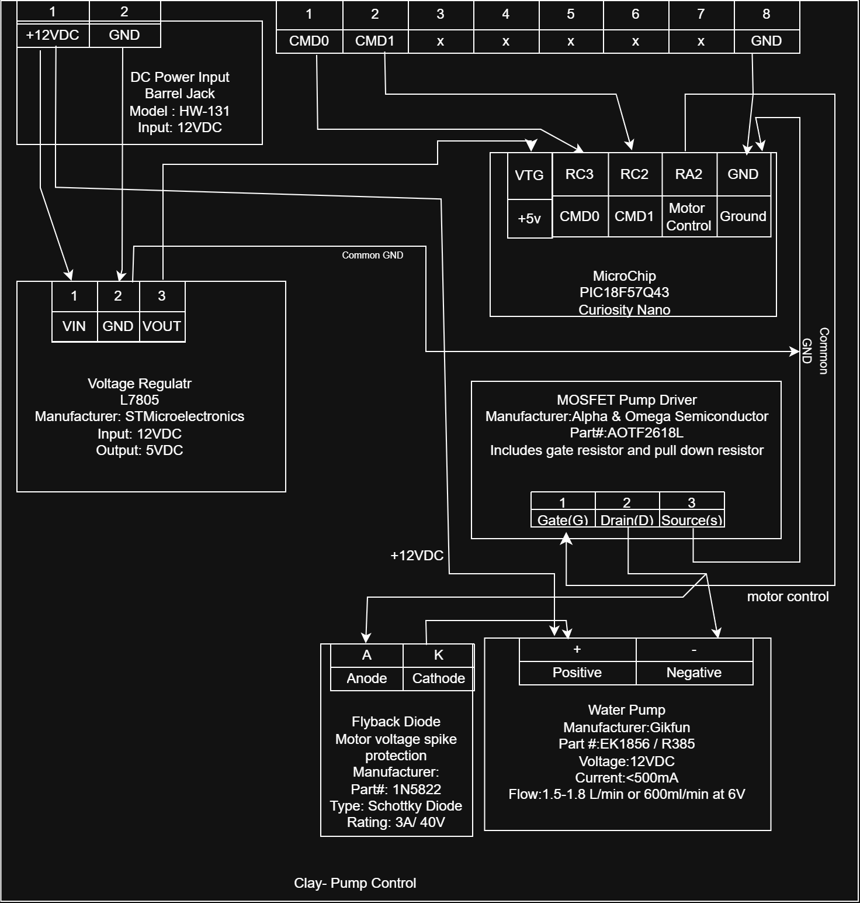

## Overview

My subsystem controls the Fill-A-Bot water pump. The main control board sends two digital command signals through the ribbon connector: CMD0 connects to RC3, and CMD1 connects to RC2. Ribbon pin 8 provides a common ground between boards.

The PIC18F57Q43 Curiosity Nano reads these inputs and controls the MOSFET through RA2. The MOSFET switches the pump’s connection to ground. The gate resistor limits current during switching, and the pull-down resistor keeps the MOSFET off when the control output is not driving it. The 1N5822 flyback diode provides a path for motor current when the MOSFET switches off, limiting the voltage spike.

The barrel jack supplies power locally. The L7805 provides a 5V supply for the control electronics, while the pump uses the motor supply directly. Power is not supplied through the ribbon connector.

## Individual Block Diagram

[Download the editable diagram and source image ZIP](Clays-block-diagram-source.zip)

## Connections

| Connection | Purpose |
|---|---|
| Ribbon pin 1 → RC3 | CMD0 digital input |
| Ribbon pin 2 → RC2 | CMD1 digital input |
| Ribbon pin 8 → GND | Common ground between boards |
| L7805 output → VTG | Planned 5V board supply; external-power configuration must be verified |
| RA2 → MOSFET gate circuit | Motor control output |

## Design Decisions
The main controller sends a two-bit pump command, written as C1 C0. Ribbon pin 1 carries C1 to RC3, and ribbon pin 2 carries C0 to RC2. The commands are 00 = Stop, 01 = Run, 10 = Stop, and 11 = Stop. The pump runs only while the command is 01. Ribbon pin 8 provides common ground.
 
The motor uses a separate power path because it requires more current than a microcontroller pin can supply. All control and motor grounds share a common reference.

## Remaining Design Work

The current single-MOSFET circuit supports one-direction operation. An H-bridge is still needed to meet the forward-and-reverse requirement.

The diagram currently shows a 12V supply. This must be reconciled with the project’s specified 9V adapter before the power design is finalized. Motor current, regulator heating, and the Curiosity Nano external-power configuration also need verification.
