# Component Selection

**Clay Belsher — Fill-A-Bot Pump Control Subsystem**

## Overview

My subsystem controls the pump that moves water from the reservoir to the container. It uses a 12 V pump, a MOSFET to turn the pump on and off, a flyback diode to protect the circuit, and a regulator that provides 5 V for the control electronics.

The pump needs to respond to the main controller and stop when the selected amount has been dispensed or the user presses Stop. The team's accuracy goal is ±1%, which still needs to be tested with the complete system.

The following tables compare three options for each major component in my subsystem. Prices are in USD and do not include shipping or taxes.

## **Pump Subsystem — Water Pump**

The pump needs to work with our power supply and move water at a useful rate. It also needs to fit the reservoir and tubing arrangement.

| Option | Unit Cost | Pros | Cons |
|---|---|---|---|
| **Gikfun EK1856 / R385** 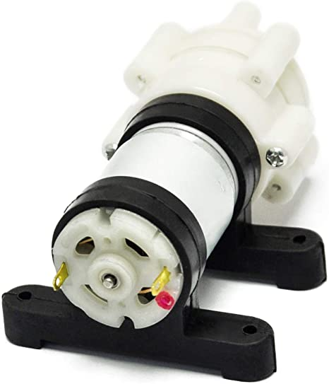 [Product and specifications](https://gikfun.com/products/gikfun-mini-dc-6v-to-12v-r385-water-cooled-water-pump-air-diaphragm-pump) | $10.88 | Works with our planned 12 V supply. Advertised maximum flow is 1.5–1.8 L/min, which could keep filling time short. Can sit outside the reservoir and connect through tubing. | Startup and stall current are not fully documented. Water passes through the pump, so the inside needs to be kept clean. Actual flow and dripping after stopping need to be tested. |
| **Adafruit 1150 Peristaltic Pump** 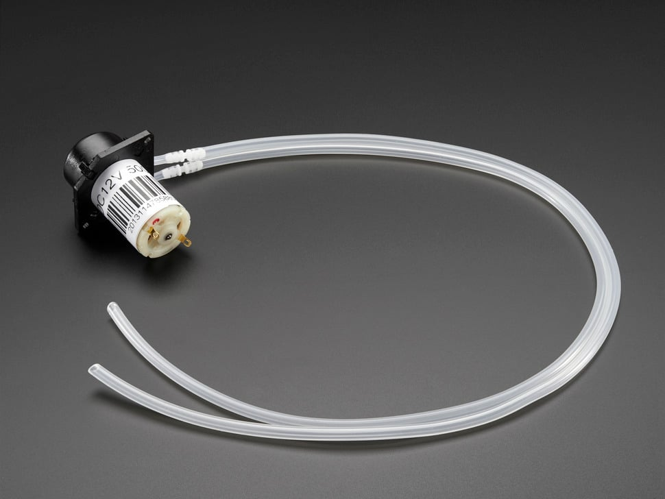 [Product and specifications](https://www.adafruit.com/product/1150) | $24.95 | Works with a 12 V supply. Water stays inside replaceable tubing, making cleaning easier. Slower flow could help when getting close to the target amount. | Maximum advertised flow is only 100 mL/min, making larger fills slow. Tubing wears out and can change the amount pumped over time. Costs more than the other pump options. |
| **DFRobot FIT0200 Immersible Pump** 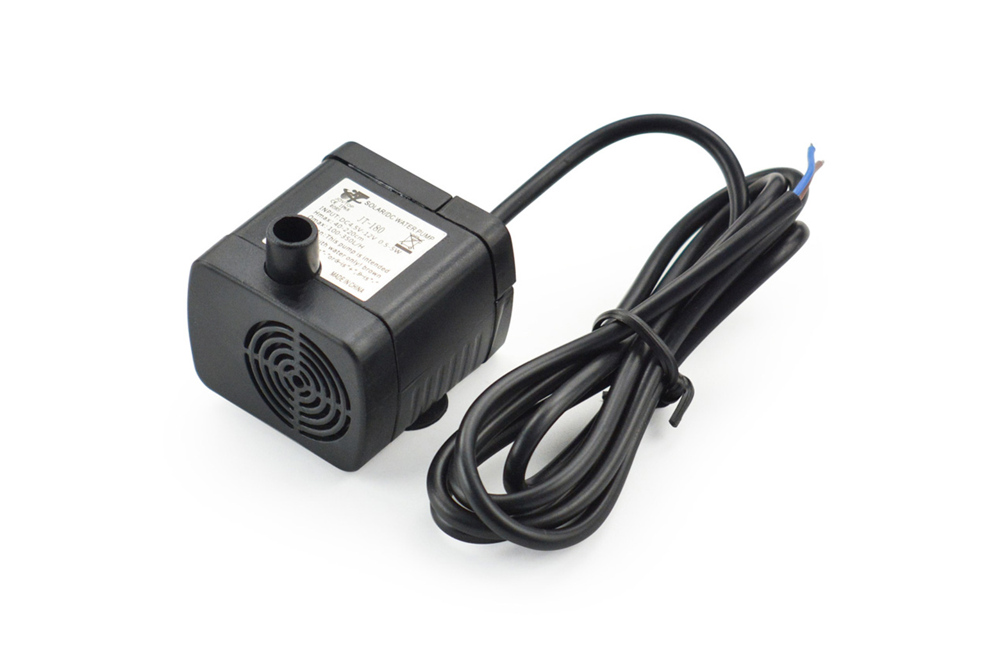 [Product and specifications](https://www.dfrobot.com/product-667.html) | $9.20 | Accepts 4.5–12 VDC. Includes water tubing. Advertised flow of 100–350 L/h could help with larger fills. | Must stay underwater while operating. Putting the pump inside the reservoir makes cleaning and removal more involved. High flow could make small amounts harder to dispense accurately. |

**Selected component: Gikfun EK1856 / R385.**

**Rationale:** I chose the R385 because it runs on our 12 V supply and fits the team's current design. It pumps faster than the peristaltic option and can sit outside the reservoir. We still need to test the actual flow, filling accuracy, and whether it keeps dripping after it stops.

**Custom option considered:** We can use a purchased pump with our own control board. Building the pump itself would add work on sealing, moving parts, and keeping the flow consistent. Using a commercial pump lets us focus on controlling and measuring the water.

## **Pump Subsystem — MOSFET Pump Driver**

The microcontroller cannot power the pump directly. The MOSFET acts as an electronic switch so the controller can turn the pump on and off using PWM. These options assume the control signal is approximately 5 V.

| Option | Unit Cost | Pros | Cons |
|---|---|---|---|
| **AOS AOTF2618L** 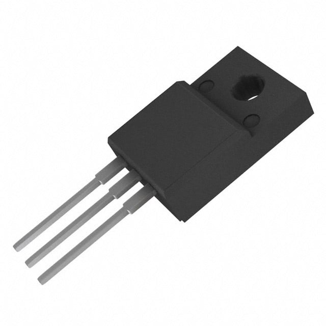 [Product listing](https://www.digikey.com/en/products/detail/alpha-omega-semiconductor-inc/AOTF2618L/3603382) [Manufacturer specifications](https://www.aosmd.com/products/mosfets/medium-voltage-mosfets-40v-400v/aotf2618l) | $1.90 | Its 60 V rating is well above our 12 V supply. Low on-resistance is specified at 4.5 V gate drive, which fits our planned control voltage. Its symbol and footprint are already in the project library. | Manufacturer lists it as Last Time Buy, so future availability is a concern. Needs a flyback diode and supporting gate components. Actual current and temperature still need to be checked. |
| **Infineon IRLZ44NPBF** 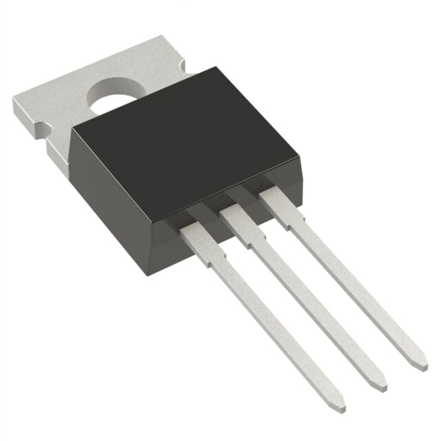 [Product listing](https://www.digikey.com/en/products/detail/infineon-technologies/IRLZ44NPBF/811808) [Datasheet](https://www.infineon.com/assets/row/public/documents/24/49/infineon-irlz44n-datasheet-en.pdf) | $1.80 | Designed to work with logic-level control signals. Its 55 V rating is above the pump supply voltage. Through-hole package is easy to solder and test. | Footprint needs to be checked before replacing the existing part. The controller's ability to drive the gate needs to be checked at the chosen PWM frequency. The metal tab connects electrically to the drain and needs care when mounting. |
| **Infineon IRLB8721PBF** 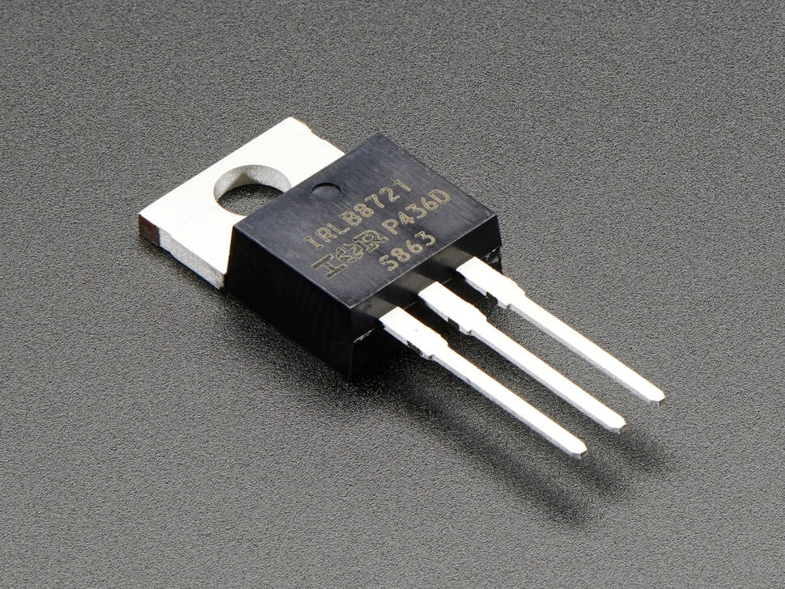 [Product listing](https://www.adafruit.com/product/355) [Datasheet](https://cdn-shop.adafruit.com/datasheets/irlb8721pbf.pdf) | $2.25 | Low on-resistance helps limit power loss while running. Works with logic-level gate drive. Through-hole package is convenient for prototyping. | Its 30 V rating leaves less room for voltage spikes than the other options. Highest listed price of the three. Pinout, footprint, and temperature still need to be checked. |

**Selected component: AOTF2618L, subject to availability.**

**Rationale:** I chose the AOTF2618L because it can switch our 12 V pump using the planned 5 V control signal. Its symbol and footprint are already in our KiCad library. The main downside is that it is being phased out, so the IRLZ44NPBF is an alternative if we cannot get it.

The circuit will also use a gate resistor and a pulldown resistor. The pulldown helps keep the pump off while the controller starts or resets. We still need to check startup current and MOSFET temperature.

**Custom option considered:** A custom MOSFET circuit handles the pump control we need. An H-bridge module would also allow direction control, but reversing the pump is not currently a project requirement. It would add parts and take up more space.

## **Pump Subsystem — 5 V Voltage Regulator**

The pump runs from 12 V, but the control electronics need 5 V. The assignment requires a linear regulator, so I compared three linear options.

| Option | Unit Cost | Pros | Cons |
|---|---|---|---|
| **ST L7805CV** 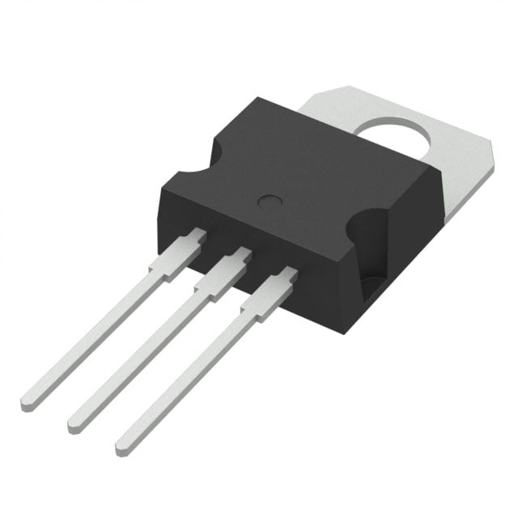 [Product listing](https://www.digikey.com/en/products/detail/stmicroelectronics/L7805CV/585964) [Datasheet](https://www.st.com/resource/en/datasheet/l78.pdf) | $1.08 | Provides a fixed 5 V output. Matches the current design. Includes current limiting and thermal shutdown. | Produces heat when dropping 12 V to 5 V. May need a heat sink depending on the load. Needs supporting capacitors and a temperature check. |
| **TI LM2940CT-5.0/NOPB** 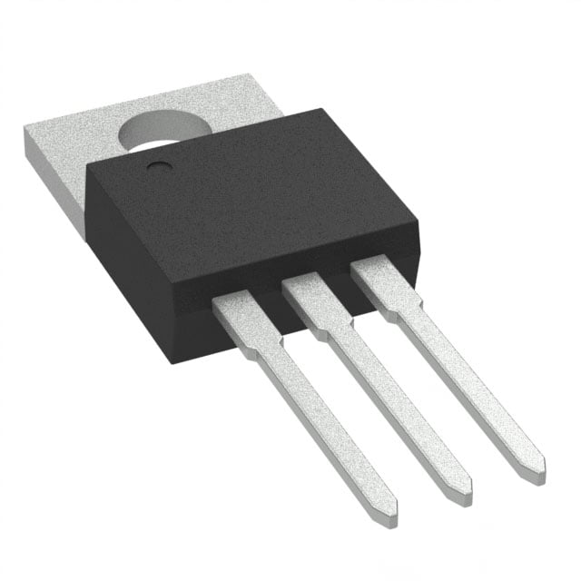 [Product listing](https://www.digikey.com/en/products/detail/texas-instruments/LM2940CT-5-0-NOPB/32575) [Datasheet](https://www.ti.com/lit/ds/symlink/lm2940-n.pdf) | $2.00 listed; out of stock when checked | Provides a fixed 5 V output. Can keep regulating with less difference between input and output voltage. Through-hole package is easy to work with. | Costs more than the L7805CV. Needs an output capacitor that meets the datasheet's size and ESR requirements. Still produces about the same heat with a 12 V input and the same load. |
| **ST LM317T**  [Product listing](https://www.digikey.com/en/products/detail/stmicroelectronics/LM317T/591677) [Datasheet](https://www.st.com/resource/en/datasheet/lm317.pdf) | $1.13 | Adjustable output could be useful if the design changes. Through-hole package is easy to solder. Includes current limiting and thermal protection. | Needs external resistors to set the output voltage. Resistor tolerance affects the output setting. Adjustability adds parts when we only need a fixed 5 V output. |

**Selected component: L7805CV.**

**Rationale:** I chose the L7805CV because we need a fixed 5 V supply and it keeps the circuit simple. The LM317T needs extra resistors to set the voltage. The LM2940 can work with a smaller input-to-output voltage difference, but that does not help much with our planned 12 V input.

Heat is the main thing I need to check. At an example load of 100 mA, dropping 12 V to 5 V would produce about 0.7 W of heat, not including the regulator's own supply current. The actual load and temperature will determine whether a heat sink is needed. The pump will stay connected to the 12 V supply.

**Custom option considered:** The regulator and its supporting capacitors will go on our pump control board. A resistor divider would not keep the output at 5 V as the load changes. A switching regulator could reduce heat, but the assignment requires a linear regulator.

## **Pump Subsystem — Flyback Diode**

The flyback diode protects the MOSFET from the voltage spike produced when the motor switches off. It needs to handle the motor current that continues flowing briefly after switching.

| Option | Unit Cost | Pros | Cons |
|---|---|---|---|
| **Diotec 1N5822** 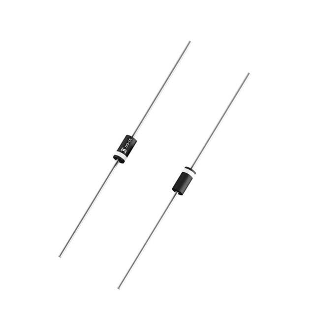 [Product listing](https://www.digikey.com/en/products/detail/diotec-semiconductor/1N5822/22599121) [Datasheet](https://diotec.com/request/datasheet/1n5820.pdf) | $0.71 | Schottky diode suitable for PWM operation. 3 A average current rating gives more capacity than the 1N5819. 40 V reverse rating is above our nominal supply voltage. | Larger package than the smaller-current option. Current capacity depends on temperature and mounting. Motor current still needs to be measured before confirming the choice. |
| **Diotec 1N5819**  [Product listing](https://www.digikey.com/en/products/detail/diotec-semiconductor/1N5819/13164178) [Datasheet](https://diotec.com/request/datasheet/1n5817.pdf) | $0.29 | Lowest listed price. Schottky diode suitable for PWM operation. Smaller package takes up less board space. | Its 1 A average current rating leaves less room for higher motor current. May not be suitable for the actual current pulses. Has the same reverse-voltage rating as the higher-current 1N5822. |
| **Vishay SB560-E3/54** 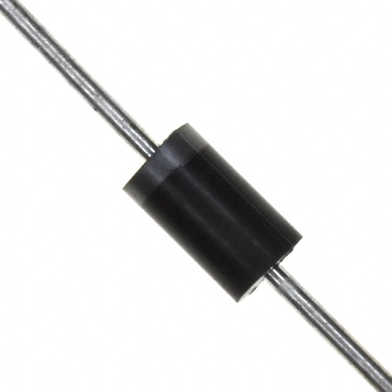 [Product listing](https://www.digikey.com/en/products/detail/vishay-general-semiconductor-diodes-division/SB560-E3-54/1023528) [Datasheet](https://www.vishay.com/docs/88721/sb520.pdf) | $1.26 | 5 A average current rating provides more capacity. 60 V reverse rating gives more room above the supply voltage. Through-hole package is easy to assemble. | Highest listed price. Larger package takes up more board space. Extra capacity may not be needed for our pump. |

**Selected component: 1N5822.**

**Rationale:** I chose the 1N5822 because it matches our design and has more current capacity than the 1N5819 without costing as much as the SB560. Its 40 V reverse rating is above our nominal 12 V supply. I still need to check the motor current and diode temperature.

The cathode connects to +12 V, and the anode connects to the pump-negative/MOSFET-drain connection. The wiring should keep the loop carrying this motor current short.

**Custom option considered:** A TVS or active-clamp circuit could change how quickly the motor current drops after switching off, but it would need more analysis. A flyback diode is a straightforward starting point. We still need to test stopping time and dripping.

## **Pump Subsystem — 12 V Power Supply**

The supply powers the pump and the input of the 5 V regulator. These options are enclosed AC/DC adapters. The output plug size and polarity need to match the board.

| Option | Unit Cost | Pros | Cons |
|---|---|---|---|
| **MEAN WELL GST25A12-P1J** 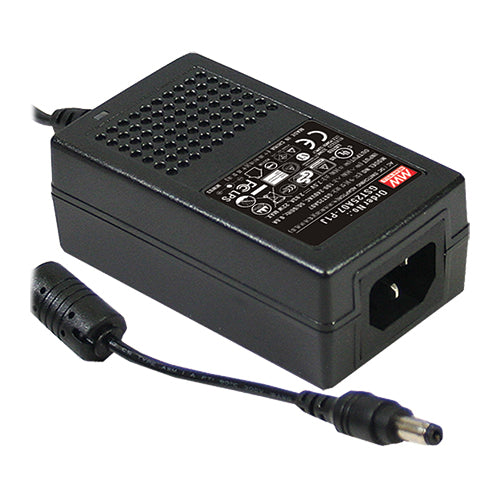 [Product listing](https://www.trcelectronics.com/products/mean-well-gst25a12-p1j) [Datasheet](https://www.meanwell.com/Upload/PDF/GST25A/GST25A-SPEC.PDF) | $18.32 | Provides regulated 12 V at up to 2.08 A. Matches the team's planned 12 V, approximately 2 A supply. Lowest listed price of the three. | Has the least extra current capacity. Startup current and the total connected load still need to be checked. A compatible AC power cord is an additional item. |
| **MEAN WELL GST40A12-P1J** 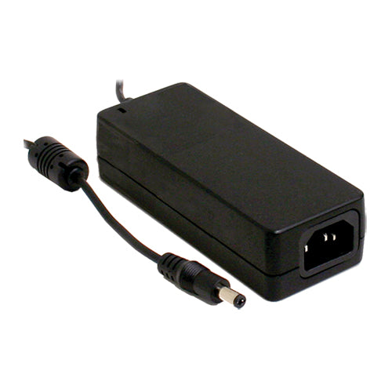 [Product listing](https://www.trcelectronics.com/products/mean-well-gst40a12-p1j) [Datasheet](https://www.meanwell.com/Upload/PDF/GST40A/GST40A-SPEC.PDF) | $22.93 | Provides regulated 12 V at up to 3.34 A. Offers more capacity for startup and other connected boards. Uses the same supply voltage as the current design. | Costs more than the 25 W option. Extra capacity may not be needed for this subsystem. Connectors and wiring still need to support the required current. |
| **MEAN WELL GST60A12-P1J** 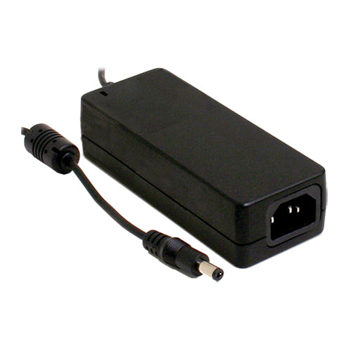 [Product listing](https://www.trcelectronics.com/products/mean-well-gst60a12-p1j) [Datasheet](https://www.meanwell.com/Upload/PDF/GST60A/GST60A-SPEC.PDF) | $24.86 | Provides regulated 12 V at up to 5 A. Has the most extra current capacity. Could support additional loads if the board connections are rated for them. | Highest listed price. Likely more capacity than the pump board needs. Does not reduce heat from the 5 V regulator. |

**Selected component: GST25A12-P1J, pending the completed power budget.**

**Rationale:** I chose the GST25A12-P1J as the starting option because it matches our planned voltage and costs less than the larger supplies. Its 2.08 A rating allows a calculated load of about 1.66 A before adding the required 25% current margin.

This choice is not final until we check startup current and include every board connected to the supply in the power budget. If we need more capacity, the larger options are available, but the connectors and wiring would also need to be checked.

**Custom option considered:** We will use a commercial enclosed adapter and build the low-voltage connections and regulator circuit on our board. Building an AC/DC supply from scratch would add work on electrical isolation and the enclosure without adding a function we need.

## **Pump Subsystem — Pin Assignments**

These assignments come from the current block diagrams. Some connections still need to be confirmed with the team before wiring the boards.

| Connection | Pin | Purpose |
|---|---|---|
| I²C data | PIC RB2; ribbon pin 1 | SDA communication with the main controller. |
| I²C clock | PIC RB1; ribbon pin 2 | SCL clock from the main controller. |
| Pump control | PIC RA2, as labeled in the pump diagram | Planned PWM output to the MOSFET gate. The PWM configuration still needs to be verified. |
| Controller power | Curiosity Nano VTG | Receives 5 V from the regulator. External power setup must follow the board instructions. |
| Common ground | PIC GND; ribbon pin 8 | Provides a shared ground between boards. |
| MOSFET gate | AOTF2618L pin 1 | Receives the control signal through a gate resistor. A pulldown keeps the pump off during reset. |
| MOSFET drain | AOTF2618L pin 2 | Connects to pump negative and the diode anode. |
| MOSFET source | AOTF2618L pin 3 | Connects to ground. |
| Flyback diode cathode | Banded end | Connects to +12 V. |
| Flyback diode anode | Unbanded end | Connects to pump negative and the MOSFET drain. |
| Regulator input | L7805CV pin 1 | Receives +12 V. |
| Regulator ground | L7805CV pin 2 | Connects to common ground. |
| Regulator output | L7805CV pin 3 | Supplies +5 V to the control electronics. |
| Pump positive | Positive terminal | Connects to +12 V. |
| Pump negative | Negative terminal | Connects to the MOSFET drain. |
| Additional pump enable | Ribbon pin 3 | Shown on the main-board diagram but not the pump diagram. Needs to be confirmed with the team. |
| Ribbon power | Ribbon pin 4 | Team documents disagree about whether this carries +5 V. Leave unconnected until the team confirms the connection. |
| Unused connections | Ribbon pins 5–7 | No assigned function in the current pump diagram. |

The MOSFET and regulator pin numbers must be checked against the datasheet package drawings before wiring.
