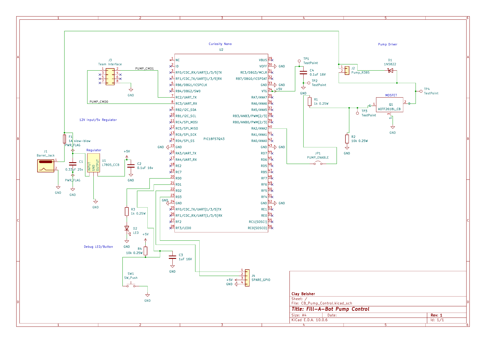

## Overview

My Fill-A-Bot pump subsystem uses a PIC18F57Q43 Curiosity Nano to control a 12 V R385 pump through a MOSFET driver. The circuit includes a 5 V regulator, fuse, flyback diode, UART interface, and debugging components.

## Schematic

## Downloads

- [Schematic PDF](CB_Pump_Control.pdf)
- [Complete KiCad project ZIP](CB_Pump_Control.zip)

## Pending Verification

The fuse rating, PWM/gate-drive performance, footprint assignments, and team UART pinout still require verification before fabrication.
