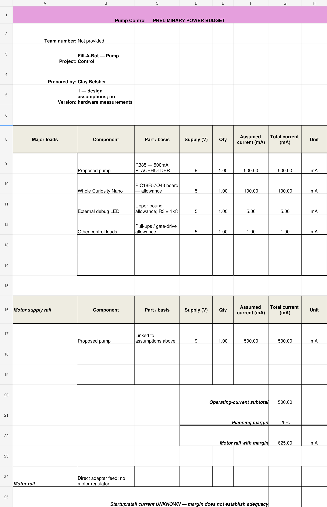
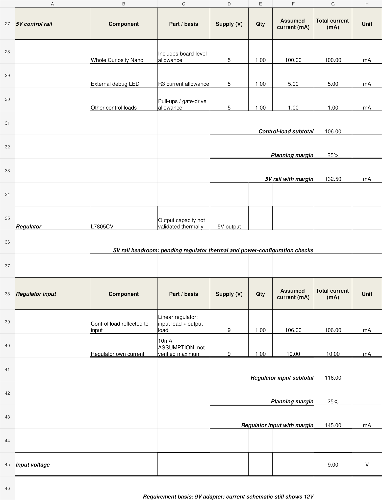
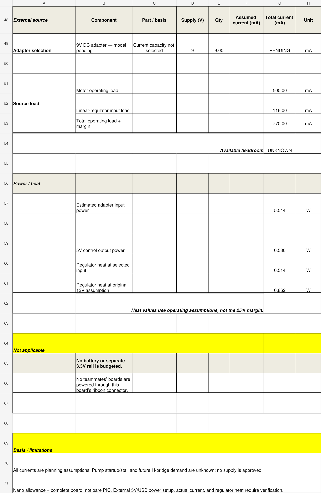

# Power Budget

**Clay Belsher — Fill-A-Bot Pump Control**

## Preliminary Design Estimate

This budget uses the course spreadsheet template for my pump board. I have the Curiosity Nano and basic lab components, but I do not have the pump yet. The current values are planning assumptions, not measurements or verified maximum ratings.

The calculation uses a 9V input to match the project requirement. My current schematic still shows 12V and needs to be updated after the supply and pump choices are resolved.

| Load | Assumed current | Basis |
|---|---:|---|
| Proposed R385 pump | 500mA | Placeholder for operating-load planning; startup and stall current unknown. |
| Complete Curiosity Nano | 100mA | Whole-board planning allowance, not a datasheet maximum or measured value. |
| External debug LED | 5mA | Upper-bound allowance using the 5V rail and 1kΩ series resistor. |
| Other control loads | 1mA | Allowance for pull-ups and gate drive; switching configuration still needs verification. |
| L7805 own operating current | 10mA | Planning allowance, not a verified maximum. |

## Results Under These Assumptions

| Result | Calculated value |
|---|---:|
| 5V control load | 106mA |
| 5V load with 25% margin | 132.5mA |
| Regulator input current, including own operating current | 116mA |
| Total adapter operating current | 616mA |
| Adapter current with 25% margin | 770mA |
| Adapter operating input power at 9V | 5.544W |
| Regulator heat at 9V, including assumed own current | 0.514W |
| Regulator heat at original 12V assumption | 0.862W |

The pump receives motor-supply power directly. Its current does not pass through the 5V regulator. The source total includes the regulator input current once; it does not add the 5V load again.

## Conclusion

These assumptions give a preliminary source requirement of 770mA after a 25% margin. That number does not establish that an adapter will start the motor or handle a stall. The adapter model and current rating remain unselected.

The budget must be revised using the actual pump current and the final H-bridge design. H-bridge losses and control demand are not included yet. Regulator temperature and the Nano external-power configuration also need verification. The regulator heat estimates do not establish that a heat sink is unnecessary.

No battery or separate 3.3V rail is used. Other team boards are outside this individual budget, and the ribbon connector does not supply their power.

## Spreadsheet Results

[Download the editable Excel power budget](CB_Pump_Power_Budget.xlsx)

[Download the Excel power budget ZIP](CB_Pump_Power_Budget.zip)
