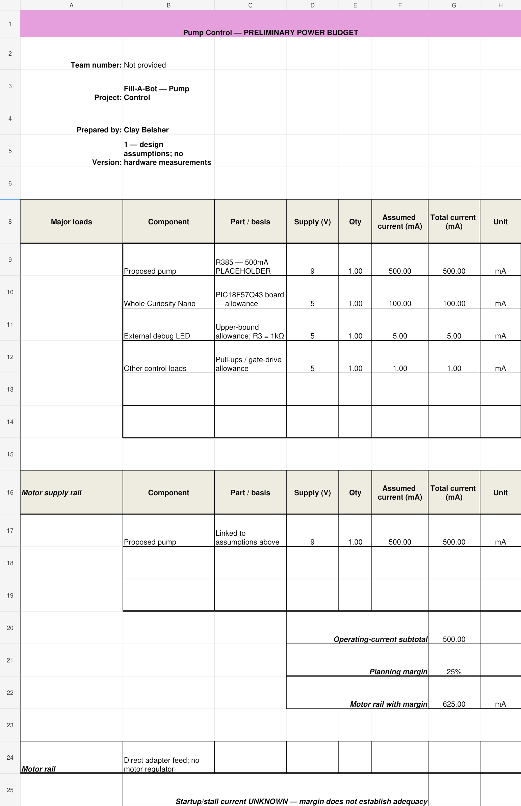
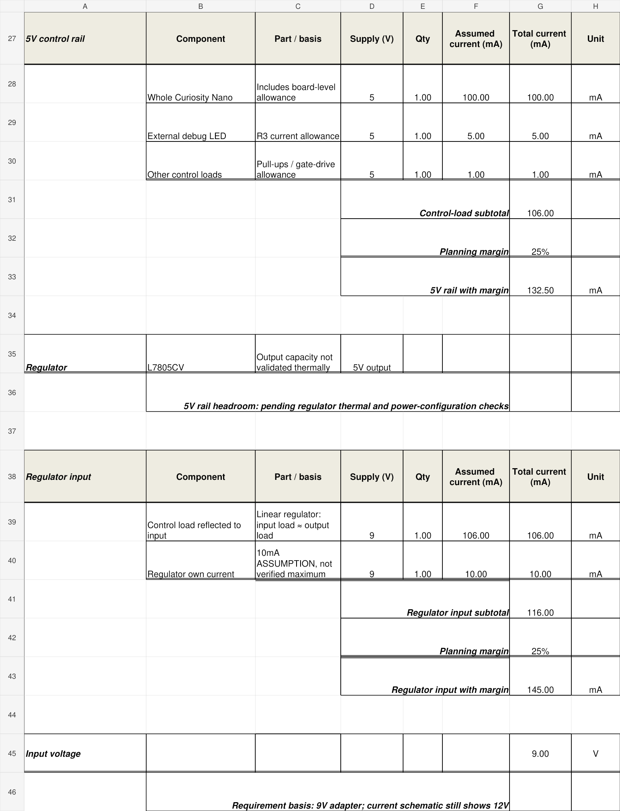
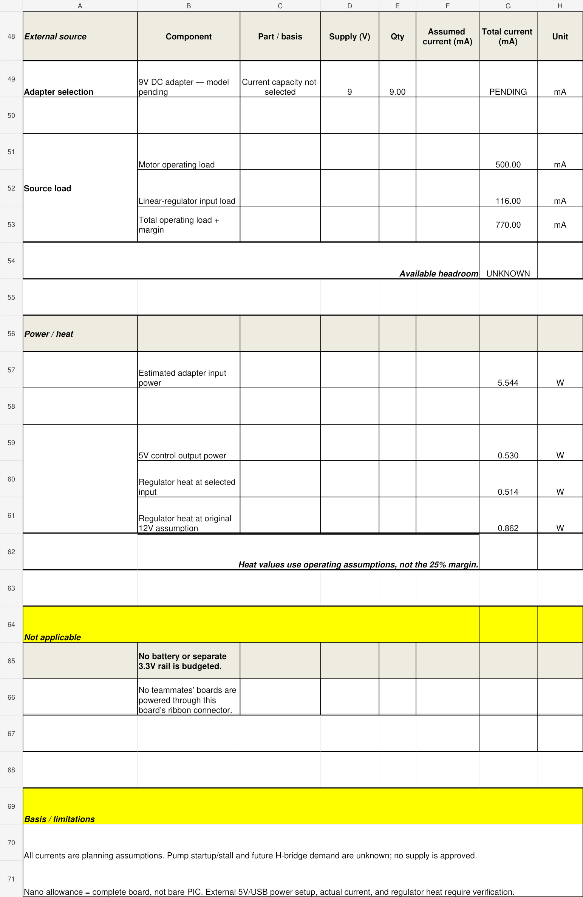

# Power Budget

**Clay Belsher — Fill-A-Bot Pump Control**

## Preliminary Design Estimate

This power budget estimates the electrical requirements of my pump-control subsystem. The current schematic uses a 12V supply for the R385 pump and DRV8871 H-bridge, with an L7805 regulator supplying the 5V control electronics.

The calculations use preliminary operating-current assumptions. Actual current consumption, startup demand, and maximum component temperatures will be verified during hardware testing.

The final supply voltage must also be checked against the course requirements.

## Estimated Current Requirements

| Component | Assumed Current | Basis |
|---|---:|---|
| R385 12V water pump | 500mA | Preliminary operating estimate; startup and stall current unknown |
| PIC18F57Q43 Curiosity Nano | 100mA | Allowance for the complete development board |
| Debug LED | 5mA | Estimated current with a 1kΩ resistor |
| Other control loads | 1mA | Allowance for signal inputs and supporting circuitry |
| L7805 operating current | 10mA | Preliminary regulator-current allowance |
| DRV8871 motor driver | Not yet quantified separately | Driver losses and supply current require verification |

## Power Budget Calculations

### 5V Control Supply

The PIC, LED, and supporting control circuitry use the regulated 5V supply.

Total control current:

100mA + 5mA + 1mA = **106mA**

With a 25% design margin:

106mA × 1.25 = **132.5mA**

### 12V Supply

The 12V source powers both the motor driver and the L7805 regulator.

Estimated regulator input current:

106mA + 10mA = **116mA**

Estimated total source current before accounting for additional DRV8871 demand:

500mA + 116mA = **616mA**

With a 25% design margin:

616mA × 1.25 = **770mA**

This is a preliminary planning value, not a verified minimum adapter rating. It does not account for motor startup or stall current, and the DRV8871's additional losses and supply current have not yet been quantified.

### Estimated Input Power

At 12V:

P = V × I

P = 12V × 0.616A

**P = 7.392W**

### Voltage Regulator Heat

The L7805 reduces the nominal 12V input to 5V.

Estimated regulator dissipation:

P = (12V − 5V) × 0.106A + (12V × 0.010A)

**P = 0.862W**

This is an approximate calculation that includes the assumed regulator operating current. Thermal testing is required to determine whether additional cooling is needed.

## Summary

| Parameter | Estimated Value |
|---|---:|
| Main supply voltage | 12V |
| Control voltage | 5V |
| Pump operating current | 500mA |
| 5V control load | 106mA |
| 5V load with 25% margin | 132.5mA |
| Regulator input current | 116mA |
| Total source current, excluding additional driver demand | 616mA |
| Source current with 25% margin, excluding additional driver demand | 770mA |
| Estimated operating input power | 7.392W |
| Estimated regulator heat dissipation | 0.862W |

## Design Considerations

The DRV8871 controls motor direction and provides current regulation. Its additional power consumption and thermal losses must be evaluated after the motor's operating and startup currents are measured.

The pump operates from the motor supply and does not draw its current through the 5V regulator.

The PIC and other control electronics use the regulated 5V supply. The Curiosity Nano's external-power configuration must be verified before connecting it.

The ribbon connector carries communication signals and a common ground reference. It does not supply motor power to the other boards.

No battery or separate 3.3V rail is included in this subsystem budget.

## Conclusion

The preliminary calculations indicate approximately **616mA operating current** from the 12V source, excluding additional DRV8871 demand, or **770mA with a 25% planning margin**.

These values are not sufficient by themselves to select the final power adapter. The actual pump startup and stall currents, DRV8871 current limit, regulator temperature, and course supply requirements must be verified before the power design is finalized.

## Spreadsheet Results

The screenshots below document the earlier 9V spreadsheet calculations. They are retained for reference and must be regenerated after the Excel workbook is updated to the 12V design.

[Download the editable Excel power budget](CB_Pump_Power_Budget_12V.xlsx)

[Download the Excel power budget ZIP](CB_Pump_Power_Budget.zip)
