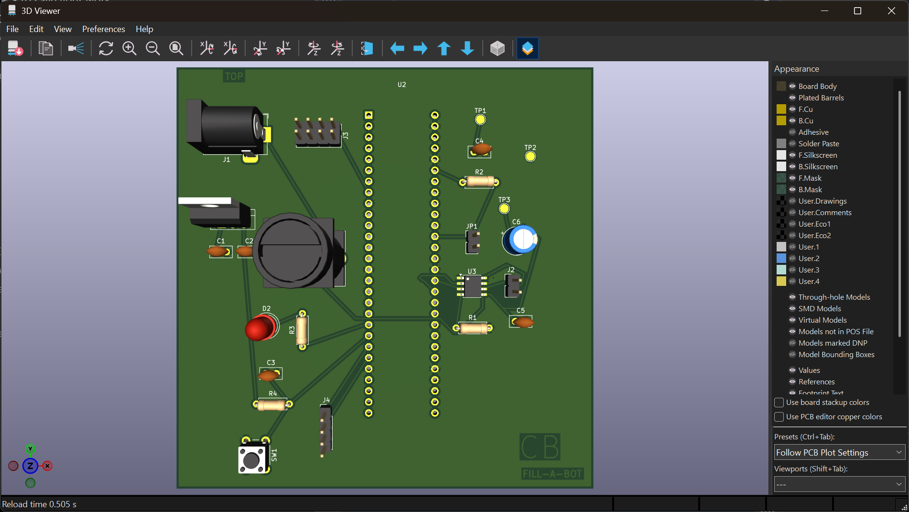
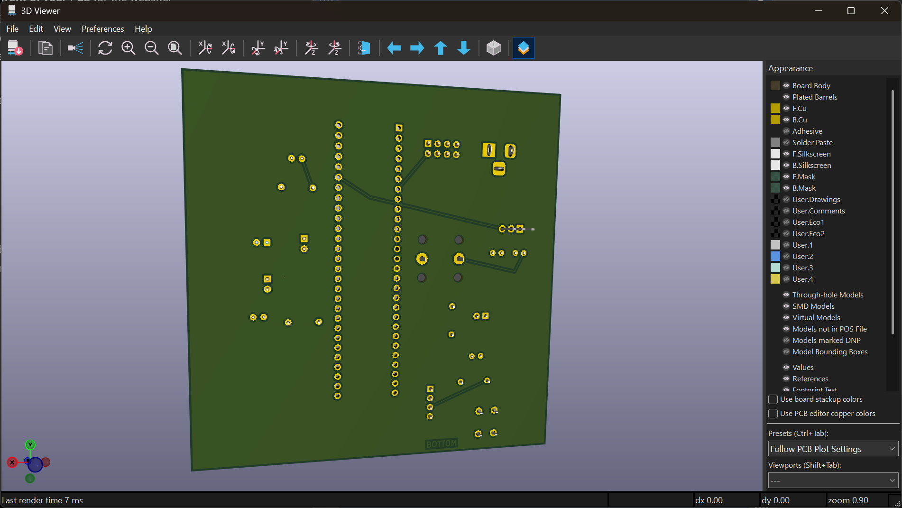

# PCB Design

This page contains the PCB design for my Fill-A-Bot pump control subsystem.

## PCB Front

## PCB Back

## Design Files

- [Download KiCad project](CB_Pump_Control%20%282%29.zip)
- [Download Gerber files](ClayBelsher201.zip)
- [Front PCB layout PDF](CB_Pump_Control-F_Cu.pdf)
- [Back PCB layout PDF](CB_Pump_Control-B_Cu.pdf)
